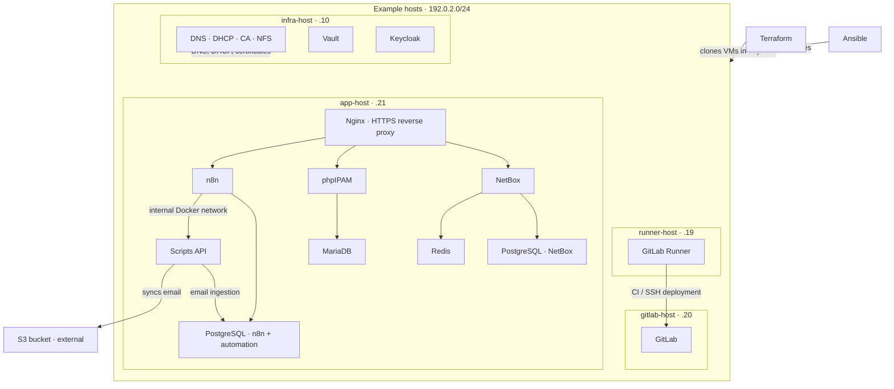

# Infrastructure as code: reference lab

I derived this repo from my real live repo, which I use to maintain my infra lab.
This version is just to show concepts, structure and maybe inspire someone...
Terraform, Ansible, Docker Compose, and systemd + different services.

> **this is not a deployable environment or a production baseline**.

> All hosts use fictional names under `example.test` and the documentation subnet `192.0.2.0/24`. Credentials, certificates, keys, state, and application data are omitted.

> Each relevant directory has a `.env_example` listing the inputs its code reads.

## Architecture at a glance

This diagram summarizes the example layout and service relationships. It is
illustrative, not a live deployment or a complete network/security design.

See [inventory.md](inventory.md) for the fictional topology and
[postgre_inventory.md](postgre_inventory.md) for database relationships.

## What to explore

| Directory | Concepts |
| --- | --- |
| [terraform](terraform/) | Clone Ubuntu VMs in vSphere; assign compute, disks, and networking |
| [ansible](ansible/) | Inventory, host variables, packages, configuration, and service lifecycle |
| [infra-services](infra-services/) | BIND DNS, DHCP, and certificate signing |
| [gitlab](gitlab/) / [gitlab-runner](gitlab-runner/) | Self-hosted source control, CI runners, and SSH deployment |
| [netbox](netbox/) / [phpipam](phpipam/) | IP address management and simple Python API examples |
| [nginx](nginx/) | TLS termination and reverse proxying |
| [n8n](n8n/) / [scripts_via_api](scripts_via_api/) | Workflows calling a token-protected Python API; email ingestion into PostgreSQL |
| [keycloak](keycloak/) / [vault](vault/) | Identity service bootstrap and a TLS-enabled secrets service |
| [nfs](nfs/) | Shared storage exports managed by Ansible |
